<div align="center">



# Lituus

**A network manager for Linux desktops that don't come with one.**<br>
<sub>🦀 Powered by Rust · drives NetworkManager</sub>

[](https://github.com/giosuel/lituus/actions/workflows/ci.yml)
[](https://github.com/giosuel/lituus/releases)
[](LICENSE)
[](https://www.rust-lang.org)
[](https://slint.dev)
[](https://networkmanager.dev)
[](#)
[](#-hyprland)

[**Website**](https://lituus.giosuel.ch/) · [**Install**](#-install) · [**Hyprland setup**](#-hyprland) · [**Shortcuts**](#%EF%B8%8F-shortcuts)

</div>

---

Running Hyprland or Sway, and reaching for `nmtui` every time the Wi-Fi changes? Lituus is the
network window those desktops are missing: everything `nmtui` does, the settings depth of KDE's
network panel, and a look that follows your wallpaper. It drives the NetworkManager you already
have, so `nmcli` and everything else keep working alongside it.

## ✨ What you get

<table>
<tr>
<td width="33%" valign="top">

**📶 Every network at a glance**<br>
Wi-Fi with signal, band and security, wired ports and VPNs, all live. Search with <kbd>/</kbd>, connect with <kbd>Enter</kbd>.

</td>
<td width="33%" valign="top">

**🔑 Passwords in your keyring**<br>
"For me only" passwords go to GNOME Keyring or KWallet, so joining a network needs no admin password. nm-applet's saved passwords are found too.

</td>
<td width="33%" valign="top">

**🛠️ Every setting**<br>
A full editor for each connection: security and 802.1X (eduroam and the like), IPv4 and IPv6, DNS, routes, MAC address, MTU, Ethernet link, and VLANs, bridges and bonds with their ports. Settings it doesn't show are left alone.

</td>
</tr>
<tr>
<td valign="top">

**🎨 Follows your wallpaper**<br>
Picks up the colours matugen writes for ML4W (or any `colors.json`) and recolours itself live. A dark and a light theme otherwise.

</td>
<td valign="top">

**🪟 Made for tiling desktops**<br>
A normal window with the app ID `ch.giosuel.Lituus` for your window rules, keyboard first, a tray icon with a quick popup for Waybar, and a background mode that answers NetworkManager at login.

</td>
<td valign="top">

**🔍 Says what went wrong**<br>
"The network rejected the password", "no polkit agent answered": failures come with the reason and a <b>Try again</b>.

</td>
</tr>
<tr>
<td valign="top">

**🛡️ WireGuard and OpenVPN**<br>
Make one, or import a `.conf` or `.ovpn` file: keys, peers, certificates and all. WireGuard connections export back to `.conf`.

</td>
<td valign="top">

**📱 Hotspot and QR codes**<br>
Share your connection over Wi-Fi in one switch, and any saved network as a QR code a phone camera joins.

</td>
<td valign="top">

**📊 What's going on**<br>
Addresses, gateway, DNS, link speed, channel, and how much has been received and sent.

</td>
</tr>
</table>

## 🚀 Install

**Arch Linux** – from the AUR: `paru -S lituus-bin` (prebuilt) or `paru -S lituus` (from source).

**Debian, Ubuntu** – the `.deb` from the [latest release](https://github.com/giosuel/lituus/releases): `sudo apt install ./lituus_*_amd64.deb`.

**Fedora, openSUSE** – the `.rpm` from the same release: `sudo dnf install ./lituus-*.x86_64.rpm`.

**AppImage (any distro)** – `Lituus-*-x86_64.AppImage` from the same release, then:

```sh
chmod +x Lituus-*-x86_64.AppImage && ./Lituus-*-x86_64.AppImage
```

**Flatpak** – `Lituus-*-linux-x64.flatpak` from the same release (the runtime comes from Flathub):

```sh
flatpak install --user ./Lituus-*-linux-x64.flatpak && flatpak run ch.giosuel.Lituus
```

What the sandbox allows, and what works differently in it, is in [`packaging/flatpak/`](packaging/flatpak/README.md).

**Nix** – `nix run github:giosuel/lituus`, or the flake as an input ([`packaging/nix/`](packaging/nix/README.md)).

Every release also has ARM64 builds (except the Flatpak). All of them need NetworkManager. Optional: NetworkManager's
OpenVPN plugin (`networkmanager-openvpn` on Arch) for OpenVPN, an XDG desktop portal with a file
dialog (`xdg-desktop-portal-gtk`, say) for choosing certificates and VPN files, a keyring,
BlueZ (`bluez`, with its service running) for Bluetooth, and PipeWire's PulseAudio service
(`pipewire-pulse`) to switch a headset between high quality and headset mode.

**From source** – with [Rust](https://rustup.rs) and fontconfig's development files:

```sh
git clone https://github.com/giosuel/lituus && cd lituus
cargo build --release
./target/release/lituus
```

## 🌊 Hyprland

Add the rules from [`extras/hyprland.lua`](extras/hyprland.lua) to `~/.config/hypr/hyprland.lua`:

```lua
local lituus = [[^(ch\.giosuel\.Lituus)$]]
hl.window_rule({ match = { class = lituus, title = "^(Lituus)$" }, float = true, size = "1040 680", center = true })
hl.window_rule({ match = { class = lituus, title = "^(Lituus quick)$" }, float = true, pin = true,
    size = { 380, 560 }, move = { "monitor_w-window_w-12", "52" } })   -- the quick popup, top right

hl.on("hyprland.start", function() hl.exec_cmd("lituus --background") end)
hl.bind("SUPER + N", hl.dsp.exec_cmd("lituus"))                     -- open the window
hl.bind("SUPER + SHIFT + N", hl.dsp.exec_cmd("lituus --quick"))     -- the quick popup
hl.bind("XF86WLAN", hl.dsp.exec_cmd("lituus --toggle-wifi"))        -- the Wi-Fi key
```

**The tray icon** shows up in Waybar's `tray` module (and any other StatusNotifierItem tray) while
Lituus runs: right-click for the menu, left-click for the quick popup. With a tray, closing the
window keeps Lituus running there; both can be turned off in Settings.

> [!TIP]
> Still on `hyprland.conf` (Hyprland 0.54 or older, or not migrated yet)? Use [`extras/hyprland.conf`](extras/hyprland.conf) instead. It also has the rule syntax for Hyprland older than 0.53.

**Why the background mode?** Passwords you keep "for me only" live in your keyring, and
NetworkManager asks Lituus for them whenever it connects, including right after you log in.
`lituus --background` runs without a window until then; `lituus` opens the window of the one
that's already running, and closing the window leaves it running.

When you join a network, Lituus asks where to keep its password:

- **For me only** (the default): in your keyring (GNOME Keyring, KeePassXC or anything else that
  speaks the Secret Service, or KWallet), and the connection is yours alone. No admin password
  needed. Without a keyring, NetworkManager keeps the password instead.
- **All users**: NetworkManager keeps it for everyone; changing it needs an admin password. On
  Hyprland that needs a polkit agent, such as `hyprpolkitagent`.
- **Ask each time**: not saved at all.

## ⌨️ Shortcuts

<details>
<summary><b>Keyboard shortcuts and CLI commands</b></summary>
<br>

| Key | Action |
|---|---|
| <kbd>/</kbd> | Search |
| <kbd>↑</kbd> <kbd>↓</kbd> | Select a network or connection |
| <kbd>Enter</kbd> | Connect |
| <kbd>E</kbd> | Edit the selected connection |
| <kbd>Esc</kbd> | Clear the search · close a dialog · leave the editor |

| Command | |
|---|---|
| `lituus` | Open the window (of the running one, if there is one) |
| `lituus --background` | Start without a window, for login |
| `lituus --quick` | Show the quick popup, or hide it (for a bar's `on-click` or a keybind) |
| `lituus --toggle-wifi` | Turn Wi-Fi on or off |
| `lituus --version` | The version |

</details>

## 🎨 Colours

Lituus takes its colours from the first usable source in `~/.config/lituus/config.toml`, and
recolours itself when that file changes, so it follows your wallpaper. Without a config file it
uses these two, then its built-in theme:

```toml
[theme]
builtin = "auto"   # or "dark" / "light": used when no source is usable

[[theme.sources]]
path = "~/.config/lituus/colors.json"

[[theme.sources]]
path = "~/.config/ml4w/colors/colors.json"   # ML4W writes matugen's colours here
```

A source is a matugen-style `colors.json` (Material colour roles such as `primary` and `surface` as
hex strings). One with missing roles, or text too faint to read, is skipped.

The Settings page writes the rest of the file (and keeps your comments in it):

```toml
[tray]
enabled = true        # the tray icon
keep_running = true   # closing the window keeps Lituus in the tray

[notifications]
enabled = true        # connected, disconnected and failed, while the window is closed
```

## 🛠️ Development

```sh
scripts/test.sh
```

runs every test, including the ones against a mock NetworkManager (python-dbusmock on a private
bus, so the real one is never touched). It needs `dbus-daemon` and python-dbusmock
(`apt install python3-dbusmock`, or `pip install python-dbusmock` in a venv with
`LITUUS_PYTHON` pointing at its `python`), and fails rather than skipping them when they're
missing. With `gnome-keyring` installed, the keyring tests also run against a real one on a
private bus.

`scripts/mock-nm.sh COMMAND` runs any command against the same mock, filled with the networks from
the mockups, for example the debug tool that prints what Lituus reads from NetworkManager:

```sh
cargo build -p lituus-cli
scripts/mock-nm.sh target/debug/lituus-cli list   # or: target/debug/lituus-cli list, for the real one
```

### Versions

The version comes from the git tags (`scripts/version.sh`): `Cargo.toml` always says `0.0.0-dev`,
and release builds write the tag's version in with `scripts/set-version.sh`.

### Dependency versions

Every crate version in `Cargo.lock` must have been public for at least 14 days, so a freshly
published (possibly compromised) release can't slip in. `cargo xtask dep-age` checks this, and CI
runs it. Security fixes and explicit exceptions go in `xtask/dep-age-exceptions.txt`, each with its
reason.

## 📜 License

[AGPL-3.0-or-later](LICENSE). The bundled fonts, Inter and JetBrains Mono, are under the [SIL Open Font License](crates/app/ui/fonts).
